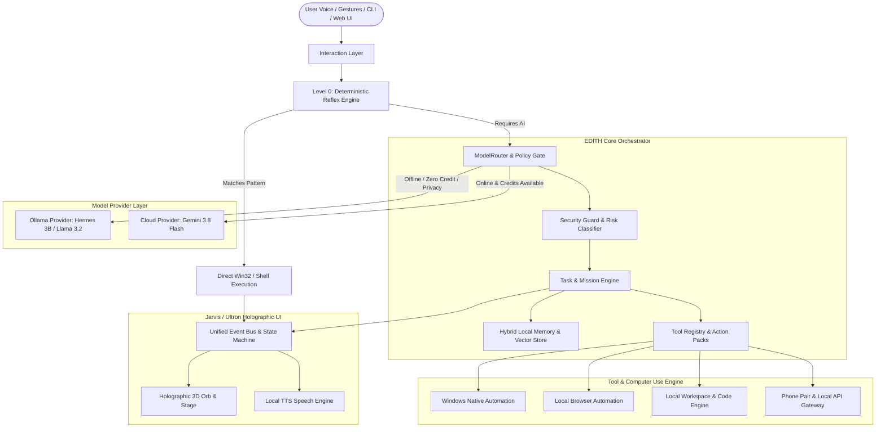

# EDITH Architecture Specification

**System:** EDITH (Autonomous Local-First AI Operating System)  
**Developer / Creator:** Jashwanth Raj  
**Target Platform:** Windows 11 (Dell Latitude 5490, Intel i5-8350U, 8GB RAM)  

---

## 1. High-Level Architecture Diagram



---

## 2. Component Architecture

```text
edith/
├── core/
│   ├── orchestrator.py      # Master dispatch loop & lifecycle manager
│   ├── state_machine.py     # Deterministic state machine (IDLE, THINKING, EXECUTING, etc.)
│   ├── event_bus.py         # Async PubSub event bus
│   ├── config.py            # Hardware profile & user settings
│   └── security.py          # Action risk analyzer, emergency stop, confirmation gate
├── providers/
│   ├── base.py              # LLMProvider, STTProvider, TTSProvider, VisionProvider
│   ├── ollama_provider.py   # Local Ollama client (Hermes 3B, Llama, Qwen-VL)
│   ├── gemini_provider.py   # Cloud fallback provider (bounded retry)
│   └── router.py            # ModelRouter (evaluates difficulty, network, credits, RAM)
├── tools/
│   ├── registry.py          # Action pack manager & tool registration
│   ├── reflex.py            # Level 0 deterministic regex & shortcut engine
│   ├── windows.py           # Native Windows automation (PowerShell, Process, Audio, Battery)
│   ├── filesystem.py        # Sandboxed file reader/writer & workspace manager
│   └── browser.py          # Local headless/headed browser controller
├── tasks/
│   ├── engine.py            # Persistent task runner & execution checkpoints
│   ├── mission.py           # Long-running multi-step goal planner & audit trail
│   └── recovery.py          # Step rollback and fault recovery engine
├── memory/
│   ├── local_store.py       # SQLite structured memory (sessions, preferences, profiles)
│   └── vector_store.py      # Local lightweight embeddings & semantic recall
├── voice/
│   ├── listener.py          # Microphone capture & local STT
│   └── speaker.py           # Speech synthesizer & barge-in handler
├── phone/
│   ├── gateway.py           # Local WebSocket/HTTP server for paired phone devices
│   └── protocol.py          # Command queue & phone authentication
└── ui/
    ├── server.py            # Local fast HTTP/WebSocket server for web client
    ├── public/              # Next.js / Three.js / MediaPipe Ultron Orb & Glass Stage
    └── state/               # State files mirror (idle, thinking, mood, audio wave)
```

---

## 3. Data & Execution Flows

### 3.1 Offline Flow
```text
Voice/Command Input
  → STT
  → Level 0 Regex Reflex Check
      ├─ Match: Win32 native tool runs (<15ms) → UI updates → Complete.
      └─ No Match: ModelRouter detects Offline → Selects Hermes 3B (Ollama)
           → Hermes generates tool call
           → Security gate validates permissions
           → Tool executes locally
           → Checkpoint saved in SQLite
           → Local TTS confirms outcome.
```

### 3.2 Cloud Fallback & Zero-Credit Flow
```text
ModelRouter routes complex query to Cloud
  → Network or Credit Failure (401, 429, timeout)
  → Bounded retry fails immediately (no loop)
  → Circuit breaker trips to ZERO_CREDIT_MODE
  → Fallback smoothly to Hermes 3B / local model
  → Task execution continues seamlessly without halting.
```

### 3.3 Security & Risk Level Flow
```text
Incoming Action
  → Risk Classifier:
      • LOW (Read file, check battery, open safe app) → Auto-execute.
      • MEDIUM (Write local file, git commit, launch browser) → Sandboxed execute.
      • HIGH (Delete files, modify system registry, execute external untrusted scripts)
          → Prompt user confirmation (UI or Phone) with exact diff and parameters.
      • EMERGENCY STOP triggered → Kill active child processes, freeze task queue.
```
