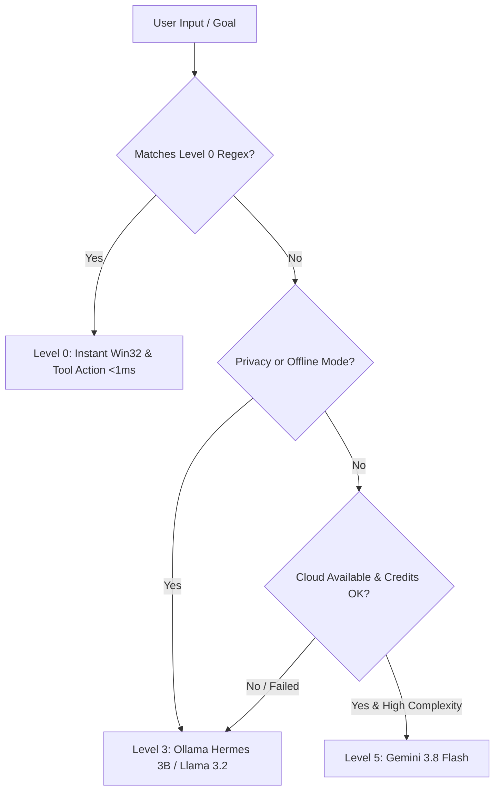

# EDITH Model Routing Specification

**Creator:** Jashwanth Raj  
**Runtime:** EDITH ModelRouter  

---

## 1. Routing Matrix

---

## 2. Model Assignments

| Category | Primary Provider | Primary Model | Fallback Model |
|---|---|---|---|
| **Fast Reflex** | Deterministic / Local | Level 0 Regex | `tinydolphin:1.1b` |
| **Tool Calling / Agent** | Ollama | `hermes3:3b` | `llama3.2:1b` |
| **Vision & Screen** | Ollama | `qwen3-vl:2b` | Deterministic OCR |
| **Coding Intelligence** | Ollama | `hhao/qwen2.5-coder-tools:0.5b` | `deepseek-coder:latest` |
| **Deep Reasoning** | Cloud (Optional) | `gemini-2.5-flash` | `deepseek-r1:1.5b` |
